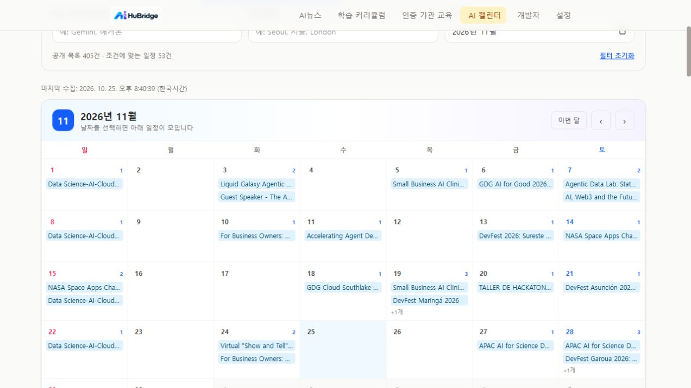

# 공개 콘텐츠 정리 및 AI 캘린더 구현 결과

> 이 문서는 과거 기록이며 현재 지시가 아니다. 현행 기준은 [AGENTS](../../AGENTS.md)·[PLAN](../../PLAN.md)·[문서 우선순위](../standards/DOCUMENTATION.md)를 따른다. 완료·미완료·수치·Git 상태는 작성 당시 기준이다.

> **이력 문서 · 현재 작업 지시가 아닙니다.** 당시 분석·검증 결과를 보존합니다. 현재 범위는 [AGENTS.md](../../AGENTS.md)·[PLAN.md](../../PLAN.md), 현재 자동화는 [AUTOMATION.md](../operations/AUTOMATION.md)를 따릅니다. 과거 기능·데이터·배포 구성을 이 문서만 보고 복구하지 마세요.

기준일: 2026-10-25. 이전 작업 커밋 `0c5886a` 이후 사용자가 확정한 범위를 반영했다.

## 사용자 확정 사항

- 로컬 모델 기능은 사용하지 않는다. 뉴스는 RSS 설명문 발췌 방식 유지.
- 용어 사전·오늘의 개념·퀴즈는 모두 삭제한다.
- 학습 커리큘럼의 체크·진도 퍼센트와 인증기관 교육의 완료 체크도 삭제한다.
- AI 교육캘린더를 **AI 캘린더**로 변경하고 교육 외에 세미나·웨비나·워크숍·해커톤·공모전·컨퍼런스·밋업 등을 다룬다.
- 출처 확대는 공개 제공 방식·접근 정책·이용 조건을 확인하여 판단한다. 외부 계정·키 제한은 유지한다.
- 시각적인 월간 달력과 필요한 정보만 편하게 보는 필터를 제공한다.
- 공개 정보 서비스의 이용안내로 정리하고 코드 MIT와 외부 콘텐츠 권리를 구분한다.

## 실제 변경

### AI 캘린더

- Google 개발자 행사 페이지가 사용하는 공개 커뮤니티 일정 JSON을 연결했다. 제목·주최 커뮤니티·현지 날짜·도시·진행 방식·주제·원문 링크만 사용한다. 본문·이미지·연락처·좌표·RSVP 기록은 복제하지 않는다.
- 실제 수집: Google 원본 995건 중 향후 AI 관련 일정 **405건** 통과, 590건 제외. 카카오 RSS는 12건 읽었으나 조건 충족 0건이다.
- 최종 집계는 취소·연기·TBD·TBA·미정 표시를 추가 제외한 결과다. 중간 집계 420건보다 15건 줄었다.
- 신청 마감이 있는 공고와 개최 날짜만 공개된 일정을 구분한다. 날짜만 있으면 시간대·시각을 만들지 않고 현지 날짜로 표시한다. 마감 미확인은 모집 중이나 참가 가능을 보장하는 상태가 아니다.
- 명확한 유형이 없으면 기타 AI 행사로 표시하고 출처 언어도 임의로 영어라고 확정하지 않는다. 제공처가 공개한 주제를 함께 표시한다.
- 원문 링크의 추적 파라미터를 제거하고 일정 제공처를 표시한다.
- RSS와 공개 일정의 출처별 실패를 격리하고, 실패한 출처의 이전 유효 일정만 보존한다. 전체 실패는 JSON을 덮어쓰지 않고 실패로 종료한다.
- 출처 판단과 제외 근거는 [SOURCE_REGISTRY.md](../standards/SOURCE_REGISTRY.md)에 기록했다. K-Startup·기업마당은 사전 허가/키 조건 때문에 자동 수집에 편입하지 않았다.

### 월간 달력과 탐색

- 7열·6주 월간 달력, 이전/다음 달 이동, 이번 달 복귀, 조회 월 직접 선택, 날짜별 일정 선택과 해제, 달력/목록 전환.
- 여러 날 행사는 기간 동안 표시하고, 월을 가로지르는 행사도 해당 월과 날짜에서 찾을 수 있다.
- 개최 일정은 파랑, 해커톤은 보라, 신청 마감은 주황으로 구분한다. 미확인 마감을 달력 마커나 D-day로 만들지 않는다.
- 유형·진행 방식·비용 확인 상태·신청 일정 확인 상태·행사/기관/주제 검색·지역 검색을 달력과 목록에 함께 적용한다.
- 선택 월 전체와 전체 기간을 전환할 수 있고, 목록은 24건씩 더 본다. 필터는 이 화면의 임시 상태이며 개인 프로필이나 저장 기록을 만들지 않는다.
- 필터와 공개 일정/온라인/이달 결과 통계를 상단에 배치하고, 날짜 버튼에 날짜·요일·건수 및 선택 상태를 제공한다. 모바일에서는 날짜 칸의 긴 제목 대신 일정/마감과 건수를 간략히 표시한다.
- [FullCalendar DayGrid 공식 문서](https://fullcalendar.io/docs/daygrid-view)의 일반적인 월간 그리드 구성을 참고해 기존 React/Tailwind로 구현했다. 외부 캘린더 패키지·유료 API는 추가하지 않았다.

### 개인화·삭제 기능 정리

- 사전 데이터·퀴즈 생성기·퀴즈 페이지·오늘의 개념·퀴즈 UI와 전용 아이콘·문자열·라우트를 삭제했다. `/quiz`는 404로 안내한다.
- 용어 단계 4항목을 제거해 학습 경로는 공식 교육·인증으로 연결되는 **3단계·11항목**이다. 난이도·분야 필터와 공식 링크는 유지한다.
- 학습 진도 바·퍼센트·완료 체크, 인증기관 교육의 완료 체크, 방문·경험치·개인 배지 관련 상태를 제거했다.
- 사용자 상태 공급자를 화면 설정 공급자로 교체했다. 이전 저장 값 중 테마만 유지하고 언어는 한국어로 고정한다. 저장 데이터는 표시 설정으로 정규화하며 개인 기록은 이어받지 않는다.
- 저장소 접근·JSON 손상·용량 오류가 화면을 중단하지 않도록 처리한다. 테마 저장 실패는 설정 화면에 안내한다.

### 뉴스와 이용안내

- 뉴스 배열·필드·URL·날짜·중복을 런타임에서 검사한다. HTTP 오류·깨진 JSON·형식 오류·네트워크 실패를 실제 0건과 구분한다.
- 10초 요청 제한과 화면 이탈 시 취소, 재시도 버튼을 추가했다. 메타만 실패하거나 건수가 맞지 않으면 정상 기사는 유지하고 수집 시각 미확인으로 안내한다.
- 마지막 수집 시각과 36시간 이상 오래됨을 표시한다. 카드에 발행일을 추가하고 홈·리서치에 공통 상태 안내를 사용한다.
- 프로젝트 하위 경로를 사용하며 selfcheck도 같은 뉴스 검증기를 사용한다. 학습 경로는 실제 교육 ID 참조를 검사한다.
- 이용안내를 로그인 없는 공개 정보 서비스에 맞추고 코드 MIT와 외부 콘텐츠·상표·이미지 권리를 구분했다. 저장 정보 안내는 표시 설정만 저장한다는 사실과 GitHub Pages/글꼴 요청을 구분했다.

## 검증 결과

| 검사 | 결과 |
|---|---|
| `npm test` | **37건 통과**: 행사 추출 13, 공개 일정 6, 뉴스 응답 8, 설정 이전/저장 4, 월간 달력 6 |
| `npm run selfcheck` | 뉴스 40건, 교육 16건, 학습 참조 11개, AI 일정 405건의 스키마·메타·중복 검사 통과 |
| `npm run lint` | TypeScript 통과 |
| `npm run build` | 통과. JS 380.93 kB / gzip 118.23 kB, CSS 39.75 kB. 기존 Tailwind sourcemap 경고 유지 |
| `npm run dev` | Vite 준비 완료 확인 |
| 실제 일정 수집 | 카카오·Google 공개 일정 읽기 성공, 최종 405건 |
| 뉴스 장애 화면 | 실제 JSON을 수정하지 않는 임시 검수 서버에서 HTTP 503 + 재시도와 정상 0건 안내를 구분해 확인 |
| 삭제 화면 | 학습 체크/퍼센트 없음, 인증 완료 버튼 없음, 퀴즈 404 확인 |
| 달력 동작 | 10월 27일 선택 시 9건, 11월 이동, 온라인 필터 시 해당 월 26건과 달력 마커 동시 반영 확인 |
| 출처 전체 일정 | 향후 405건 중 온라인 53건. 개별 원문 405건의 신청 가능 여부를 전수 확인한 것은 아님 |
| 원격 변경 확인 | 읽기 전용 조회에서 origin/master는 `c747efdc` 확인. 이번 작업 중 원격 푸시·배포 없음 |

## 남은 범위

- 현재 운영 주소의 기존 배포 정상 여부와 이번 로컬 변경 반영은 구분한다. 푸시·배포는 `AGENTS.md`에 따라 명시적 요청 후 진행한다.
- 예약 수집 봇 커밋 이후 자동 배포의 연결·실행 로그·운영 JSON 반영 검증은 별도 작업이다.
- 국내 교육기관 모집 출처 확대는 허가 조건을 충족하는 자료가 확인될 때 추가한다. 원문 변경·취소 반영이 늦을 수 있으므로 제공처 확인이 필요하다.
- 해외 날짜만 공개된 행사는 실제 시간대가 불명확하여 UTC+14 기준부터 보수적으로 제외한다. 일부 임박 일정이 일찍 빠질 수 있다.
- 모바일·키보드·다크모드 접근성 전수 검수, 교육기관 16건의 가격·무료 수료증 조건 전수 재확인, 운영 주체의 실제 공개 문의 경로 보완은 후속 과제다.
- 이번 변경은 개인화·로그인·북마크·학습 기록 기능을 재도입하지 않는다.
